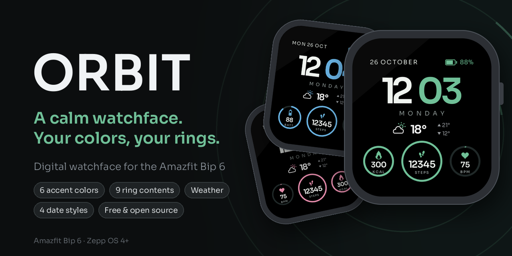
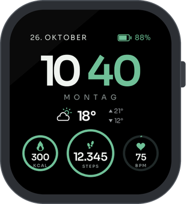
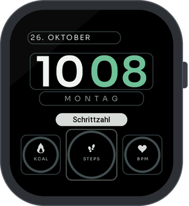
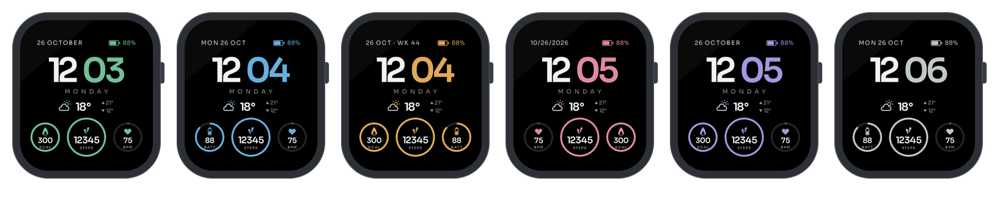

  

  
  
  
  

  <a href="#-get-it-on-your-watch">Install</a> ·
  <a href="#-features">Features</a> ·
  <a href="CHANGELOG.md">What's new</a> ·
  <a href="#-testers-wanted">Testers wanted</a> ·
  <a href="docs/DEVELOPMENT.md">Development</a>

<h3 align="center">
  Big, clear time. Weather at a glance. 
  Three rings with what matters to you – in your color.
</h3>

 

  
  &nbsp;
  

## 🎨 Six colors

Everything that glows mint in the default look – the minutes, the rings, the icons and the battery – takes the color
you pick: **Mint, Ice blue, Amber, Rose, Lavender or Silver**.

  

## ✨ Features

**⌚ On the watchface**

- **Time** in large Sora digits, hours white and minutes in your color; 12- or 24-hour format as set on the watch
- **Date and battery** on top; the battery turns red below 5 %
- **Weather:** icon, current temperature, high and low of the day
- **Three rings** that fill up towards your goal; the middle one is larger and shows up to 99,999 in full
- **Tap a ring** to open the matching app, tap the weather for the forecast
- **Always-on display:** a dimmed, minimal time
- **Languages:** English and German, the rest of the world gets English

**✏️ In the editor** (long-press the watchface, then the pencil)

- **Accent color:** six colors
- **Each ring:** steps, heart rate, calories, battery, distance (km or miles, as set on the watch), PAI, stand,
  SpO₂, stress – or empty
- **Date:** “26 OCTOBER”, “MON 26 OCT”, “10/26/2026” or “26 OCT · WK 44”
- **Row under the time:** weekday or empty

**🔋 Light on the battery**

- Only the sensors of the rings you see are used, and their values arrive as events – no polling
- Weather, temperatures and the always-on time are drawn by the watch itself
- The heart-rate ring shows your zone: almost empty at rest, full at your maximum (220 minus your age)

## ⌚ Get it on your watch

ORBIT runs on the **Amazfit Bip 6** (Zepp OS 4 or newer). It is not in the Zepp app store yet;
grab the newest version from the **[Releases](https://github.com/fat-toni/ORBIT-Watchface/releases/latest)**.

| | 📱 With the Zepp app | 🤖 With Gadgetbridge |
|---|---|---|
| **For you if** | you use the Zepp app (iPhone or Android) | you already use [Gadgetbridge](https://gadgetbridge.org) on Android instead of the Zepp app |
| **You need** | a computer with Node.js | nothing else |
| **How** | run `zeus preview`, scan the QR code under **Watch Face** | open the `.zab` file from the release with Gadgetbridge |

👉 **[Step-by-step guide](docs/INSTALL.md)** for both ways (Windows, macOS and Linux)

## 🙋 Testers wanted

> [!TIP]
> **Got another square Amazfit watch with Zepp OS 4+?** ORBIT is made for the Bip 6, and the Active 2 (Square) and
> Bip Max have the same screen – I would love to bring it to them, and later to round watches too.
>
> 1. Open an **[issue](https://github.com/fat-toni/ORBIT-Watchface/issues/new?title=Tester:%20)** with your watch model and
>    its Zepp OS version (on the watch: Settings → About).
> 2. You get a test build for your watch.
> 3. Wear it for a day and tell me what looks wrong. Photos of the watch help a lot.

---

  Made with ☕ by Toni &amp; Claude · Code: <a href="LICENSE">GPL-3.0</a> © 2026 Toni · Font: Sora (SIL OFL 1.1), see <a href="CREDITS.md">credits</a> · <a href="PRIVACY.md">Privacy</a>

